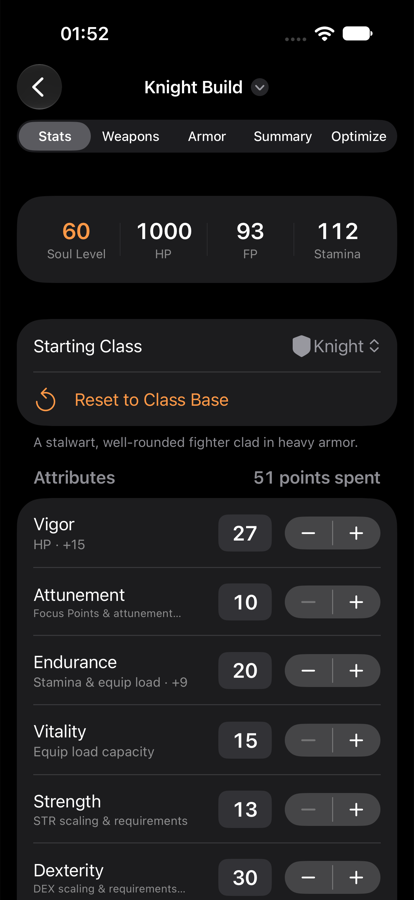
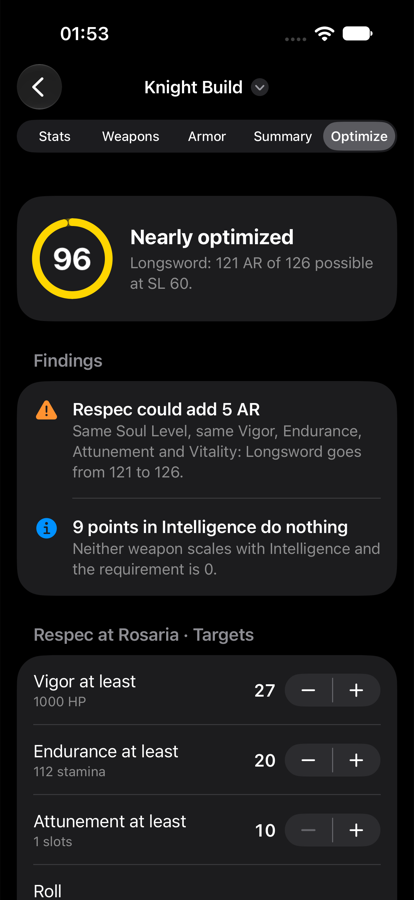
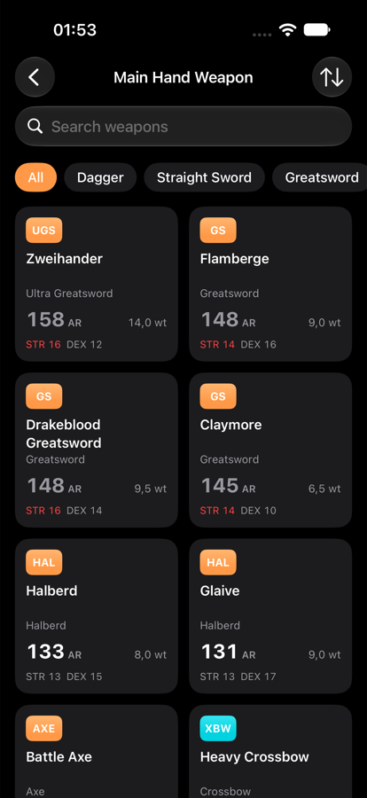

# Ashen Build

> **Alpha.** Ashen Build is incomplete and under active development. The weapon and armor catalogs are partial, the attack-rating model is approximate, and the app is not on the App Store yet. Treat the numbers as a planning aid, not as exact in-game values.

**A unified min-max builder for Dark Souls III, on iPhone.**

Ashen Build is a model for optimization in games. Every choice that shapes a character (starting class, attributes, weapon, infusion, armor, rings) feeds one calculator, and an optimizer searches the alternatives around it. You can test your own methods and theories on paper (a respec, a ring setup, a heavier armor set) without spending souls, Pale Tongues, upgrade materials or hours of play.

The question it answers: **is my build optimized enough, and what would be better?**

<p>
  
  
  
  
  
</p>

## What works today

| Area | Status |
|---|---|
| Starting classes (all 10) with correct base stats | Done |
| Attributes: type a value or use the stepper; values below the class base are refused | Done |
| HP, FP, stamina, equip load, roll thresholds (fast / mid / fat) | Done, from community-documented tables |
| Rings: pick a ring, then its +1 / +2 / +3 level; no duplicates | Done (76 variants) |
| Ring effects for *your* build, e.g. "AR 121 → 145 at or below 20% HP" | Done |
| Weapon grid showing the attack rating your character would get with each weapon | Done (63 weapons) |
| Armor sorted by any stat (poise, lightning, bleed, weight…) | Done (36 pieces) |
| Optimizer: score, findings, Rosaria respec, best infusion, strongest weapons | Done |
| Armor min-max search for a target roll and poise floor | Done |
| Full weapon and armor catalogs | Not yet |
| Exact per-weapon attack-rating tables, spells, buffs, split damage vs. enemy defenses | Not yet |

## How the optimizer works

**Respec at Rosaria.** Soul Level and starting class stay fixed. The optimizer first sets the floors: the class base, your own targets for Vigor, Endurance and Attunement, enough Vitality for the roll you want, and the stat requirements of both weapons (ring bonuses included, two-handing counted). Each remaining point then goes to the damage stat that adds the most attack rating. Scaling only flattens as a stat rises and each stat contributes independently, so this greedy pass finds the best split for the model. Points that add almost no damage go to Vigor, then Endurance.

**Verdict.** Your current attack rating is compared with the best respec that keeps the same Vigor, Endurance, Attunement and Vitality. The app also flags wasted points, stats past their soft caps, how far you are from the next roll threshold, and which starting class would have reached the same stats at a lower level.

**Alternatives.** Every infusion of your weapon, and every weapon in the catalog with its best infusion, is evaluated with its own respec at the same upgrade progress and roll.

**Armor.** For a chosen stat, roll and optional poise floor, the search checks every combination of the four armor slots after removing pieces that another piece in the same slot beats on weight, the chosen stat and poise at once.

The same approach (a calculator for derived stats, constraints, an objective and a search) is not specific to one game, which is why the project is framed as a model for game optimization.

## Accuracy and data

- Starting classes, ring effects and the HP / stamina / FP / equip-load tables were checked against the community [Fextralife Dark Souls III wiki](https://darksouls3.wiki.fextralife.com/) (November 2026). Values are numbers and game facts; descriptions in the app are written for this project.
- The weapon and armor catalogs are a subset of the game.
- Attack rating uses a simplified scaling model. Comparisons between options are meaningful; absolute numbers can differ from the game.

## Build and run

Requirements: Xcode 26 or later, iOS 17+ simulator or device.

```bash
open AshenBuild.xcodeproj
```

Tests:

```bash
xcodebuild test -project AshenBuild.xcodeproj -scheme AshenBuild -destination 'platform=iOS Simulator,name=iPhone 17 Pro'
```

Code map: game data in `AshenBuild/GameData/*.json`, stat curves in `Formulas.swift`, build math in `BuildCalculator.swift`, search and verdict in `Optimizer.swift`, SwiftUI screens in `AshenBuild/Views`.

## Roadmap

1. Complete weapon, shield, catalyst and armor catalogs.
2. Exact attack-rating model with per-weapon scaling and correction curves.
3. Damage against enemy defenses and spell/buff calculations.
4. TestFlight beta (being prepared: see [AppStore/README.md](AppStore/README.md)), then the App Store.

## How it was built

Product idea, feature design, decisions and testing by the author. The code was written with Claude Code (Anthropic) under the author's direction and checked in the iOS simulator and with unit tests.

## Legal

Ashen Build is an unofficial, fan-made tool. It is not affiliated with, endorsed, sponsored or approved by FromSoftware or Bandai Namco Entertainment. Dark Souls and all related names are trademarks of their respective owners and are used only to identify the game this tool is for. The app contains no game assets; the icon and interface are original. The app collects no data; builds are stored only on the device.

## License

[MIT](LICENSE)
